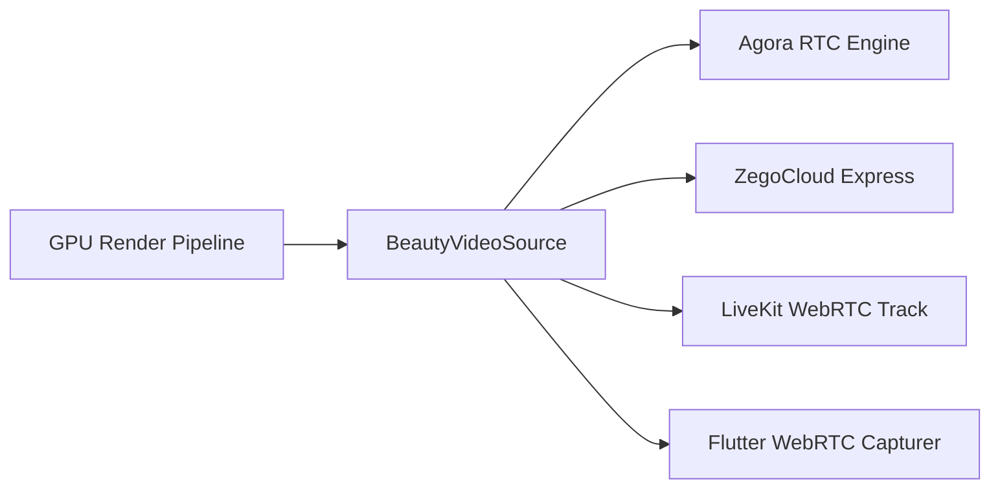

# Streaming Integrations Guide

`flutter_live_beauty` is designed from the ground up for real-time live-streaming applications. Unlike standard preview-only camera plugins, this SDK outputs the **actual processed camera frames** so that the video sent to broadcast viewers reflects the applied beauty filters.

---

## Architecture of `BeautyVideoSource`



### Frame Lifecycle & Anti-Stalling Latency Policy
1. Native render thread completes shader processing.
2. The frame is placed into a single-frame buffer (`capacity = 1`).
3. If downstream encoder/streaming SDK is currently consuming the previous frame, subsequent intermediate frames are dropped to **prevent queue buildup and maintain latency < 33ms**.
4. Memory buffers are pooled and reused to prevent garbage collection pauses.

---

## 1. Agora RTC Integration (`agora_rtc_engine`)

### Setup Instructions
Add `agora_rtc_engine` to your app's `pubspec.yaml`:
```yaml
dependencies:
  agora_rtc_engine: ^6.3.0
  flutter_live_beauty:
    path: ../flutter_live_beauty
```

### Integration Code
```dart
import 'package:agora_rtc_engine/agora_rtc_engine.dart';
import 'package:flutter_live_beauty/flutter_live_beauty.dart';

final controller = LiveBeautyController();
await controller.initialize();

// Configure Agora Custom Video Source
final rtcEngine = createAgoraRtcEngine();
await rtcEngine.initialize(const RtcEngineContext(appId: 'YOUR_AGORA_APP_ID'));

await rtcEngine.getMediaEngine().setExternalVideoSource(
  enabled: true,
  useTexture: false,
  sourceType: VideoSourceType.videoSourceCamera,
);

// Connect Beauty Video Source to Agora
final agoraAdapter = AgoraBeautyVideoAdapter(
  videoSource: controller.videoSource,
  onPushFrame: (agoraFrame) {
    rtcEngine.getMediaEngine().pushExternalVideoFrame(
      frame: ExternalVideoFrame(
        type: VideoBufferType.videoBufferRawData,
        format: VideoPixelFormat.values[agoraFrame.format],
        buffer: agoraFrame.buffer,
        stride: agoraFrame.stride,
        height: agoraFrame.height,
        rotation: agoraFrame.rotation,
        timestamp: agoraFrame.timestampMs,
      ),
    );
  },
);

await controller.startStreaming();
await agoraAdapter.start();
```

---

## 2. ZegoCloud Express Video (`zego_express_engine`)

### Setup Instructions
Add `zego_express_engine` to your `pubspec.yaml`:
```yaml
dependencies:
  zego_express_engine: ^3.14.0
```

### Integration Code
```dart
import 'package:flutter_live_beauty/flutter_live_beauty.dart';
import 'package:zego_express_engine/zego_express_engine.dart';

final controller = LiveBeautyController();
await controller.initialize();

// Enable custom video capture in Zego
final customCaptureConfig = ZegoCustomVideoCaptureConfig(ZegoVideoBufferType.RawData);
await ZegoExpressEngine.instance.enableCustomVideoCapture(true, config: customCaptureConfig);

final zegoAdapter = ZegoBeautyVideoAdapter(
  videoSource: controller.videoSource,
  onSendRawFrame: (rawFrame) {
    ZegoExpressEngine.instance.sendCustomVideoCaptureRawData(
      rawFrame.data,
      rawFrame.length,
      rawFrame.param,
      rawFrame.timestampMs,
    );
  },
);

await controller.startStreaming();
await zegoAdapter.start();
```

---

## 3. LiveKit Integration (`livekit_client`)

### Setup Instructions
```yaml
dependencies:
  livekit_client: ^2.2.0
```

### Integration Code
```dart
import 'package:flutter_live_beauty/flutter_live_beauty.dart';
import 'package:livekit_client/livekit_client.dart';

final controller = LiveBeautyController();
await controller.initialize();

final liveKitAdapter = LiveKitBeautyVideoAdapter(
  videoSource: controller.videoSource,
  onFrameCaptured: (customFrame) {
    customVideoCapturer.captureFrame(
      customFrame.buffer,
      customFrame.width,
      customFrame.height,
      rotation: customFrame.rotation,
      timestampUs: customFrame.timestampUs,
    );
  },
);

await controller.startStreaming();
await liveKitAdapter.start();
```

---

## 4. Flutter WebRTC Integration (`flutter_webrtc`)

### Setup Instructions
```yaml
dependencies:
  flutter_webrtc: ^0.11.0
```

### Integration Code
```dart
import 'package:flutter_live_beauty/flutter_live_beauty.dart';
import 'package:flutter_webrtc/flutter_webrtc.dart';

final controller = LiveBeautyController();
await controller.initialize();

final webrtcAdapter = WebRtcBeautyVideoAdapter(
  videoSource: controller.videoSource,
  onPushWebRtcFrame: (rtcFrame) {
    customVideoCapturer.captureByteFrame(
      rtcFrame.data,
      rtcFrame.width,
      rtcFrame.height,
      rtcFrame.rotation,
      rtcFrame.timestampUs,
    );
  },
);

await controller.startStreaming();
await webrtcAdapter.start();
```
